# t3-cosplay 🎭

> T3 Code, dressing up as other apps for fun.

A small collection of [T3 Code](https://github.com/pingdotgg/t3code) themes that make your coding agent look like the tools you either love or still see in your nightmares.

## The themes

| Theme | Costume | Vibe | Best in |
| --- | --- | --- | --- |
| 🧡 [**Cursor**](./themes/cursor.json) | Warm off-black `#14120B` and paper-cream `#F7F7F4`, Cursor orange `#F54E00` accent, ink-colored send button | Calm, focused, a little bit literary | Both |
| 💜 [**Teams**](./themes/teams.json) | Purple header bar `#464775`, lavender bubbles, purple underline on the message box, Segoe UI | Corporate flashbacks, now with type-checking | Light |
| 🍆 [**Slack**](./themes/slack.json) | Aubergine sidebar `#3F0E40`, blue selected row `#1164A3`, green send button `#007A5A`, Lato | Every thread is a huddle now | Light |
| 🎮 [**Discord**](./themes/discord.json) | Charcoal `#313338`, blurple `#5865F2`, borderless filled message box, green switches | Gaming chat, but the raid is a refactor | Dark |
| 📝 [**Notion**](./themes/notion.json) | Warm ink `#37352F` on white, `#F7F7F5` sidebar, blue `#2383E2`, red inline-code chips, soft shadows | Your agent, but make it a doc | Light |
| 🐙 [**GitHub**](./themes/github.json) | Primer `#0D1117` / `#010409`, green merge-style send button, blue focus ring, monospace inline code | Feels like code review at 2am | Dark |
| 🎧 [**Spotify**](./themes/spotify.json) | Black and `#121212`, green `#1ED760` with black text, pill buttons, send button grows on hover | Lo-fi beats to ship features to | Dark |
| ✖️ [**X**](./themes/x.json) | Pure black "Lights out" `#000000`, blue `#1D9BF0`, white pill send button, rounded everything, Chirp if you have it | Doomscrolling, but it compiles | Dark |
| 🟣 [**Linear**](./themes/linear.json) | Near-black `#0F1011` with a darker `#08090A` sidebar, indigo `#5E6AD2`, Inter, thin icons, quiet borders | Issue tracker energy, zero backlog guilt | Dark |
| ▲ [**Vercel**](./themes/vercel.json) | Black and white with `#0070F3` blue, monochrome send button and switches, Geist and Geist Mono | Ship it to prod, ask questions never | Dark |
| 💬 [**WhatsApp**](./themes/whatsapp.json) | Beige chat wallpaper `#EFEAE2`, mint green bubbles `#D9FDD3`, teal `#00A884` send button; dark has `#005C4B` bubbles | Your agent texts back faster than your friends | Light |
| ▶️ [**YouTube**](./themes/youtube.json) | `#0F0F0F` canvas, chip-grey `#272727` controls, red `#FF0033` accent, Subscribe-style send button, Roboto | Like, subscribe and hit the merge button | Dark |
| ✳️ [**Claude Code**](./themes/claude-code.json) | Charcoal `#262624` with a darker `#1F1E1D` sidebar, ivory `#FAF9F5` light mode, terracotta `#D97757` accent, rounded-square `#C6613F` send button, serif replies | Your agent, cosplaying as… a coding agent | Both |

Every theme ships both light and dark variants. Spotify has no light mode, so its light variant is our own take.

## Previews

<table>
  <tr>
    <th>Light</th>
    <th>Dark</th>
  </tr>
  <tr>
    <td colspan="2"><b>Cursor</b></td>
  </tr>
  <tr>
    <td>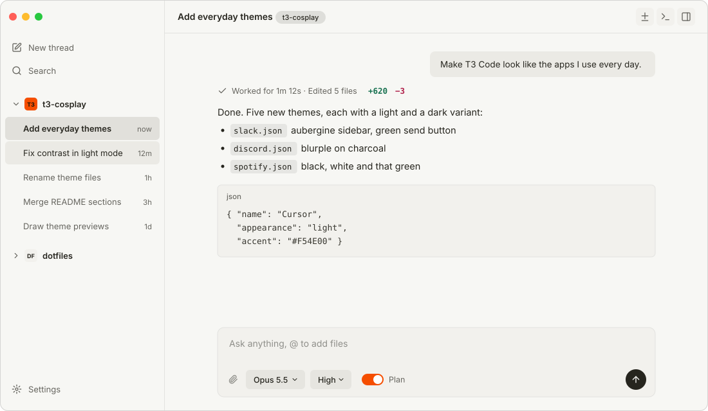</td>
    <td>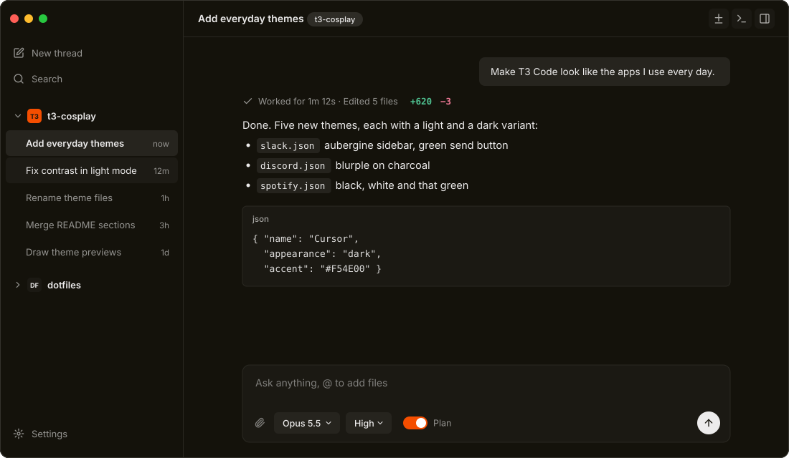</td>
  </tr>
  <tr>
    <td colspan="2"><b>Teams</b></td>
  </tr>
  <tr>
    <td></td>
    <td></td>
  </tr>
  <tr>
    <td colspan="2"><b>Slack</b></td>
  </tr>
  <tr>
    <td></td>
    <td></td>
  </tr>
  <tr>
    <td colspan="2"><b>Discord</b></td>
  </tr>
  <tr>
    <td></td>
    <td>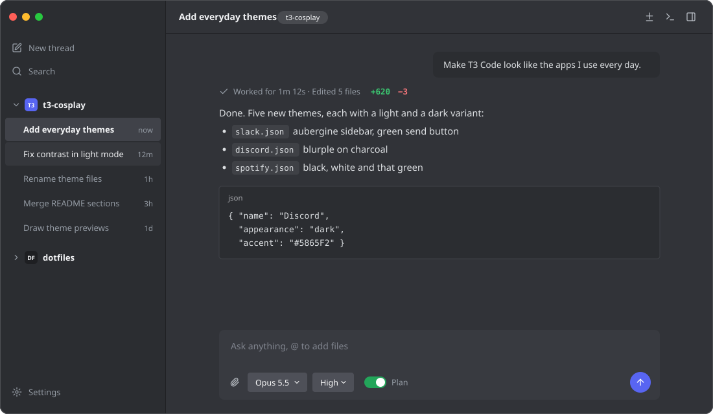</td>
  </tr>
  <tr>
    <td colspan="2"><b>Notion</b></td>
  </tr>
  <tr>
    <td></td>
    <td>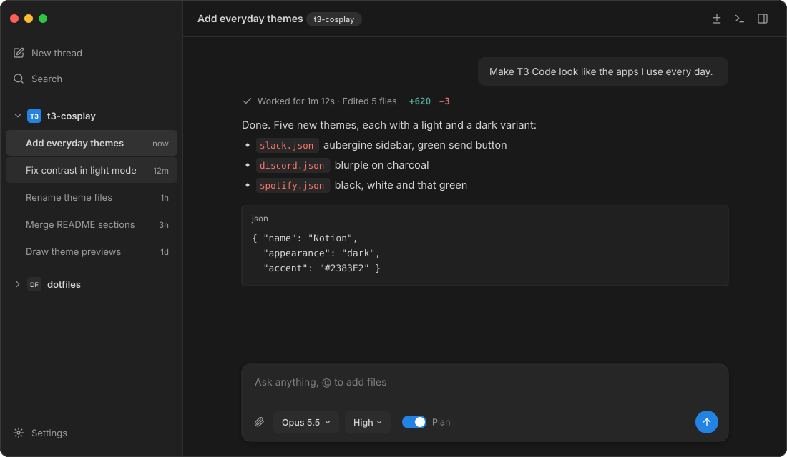</td>
  </tr>
  <tr>
    <td colspan="2"><b>GitHub</b></td>
  </tr>
  <tr>
    <td>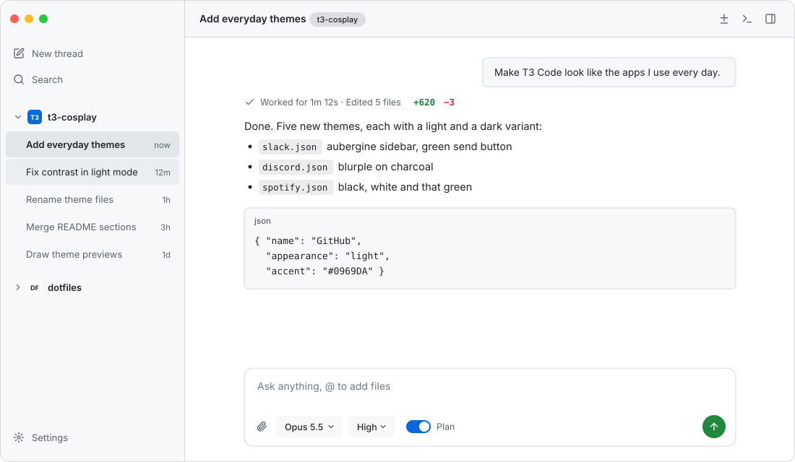</td>
    <td></td>
  </tr>
  <tr>
    <td colspan="2"><b>Spotify</b></td>
  </tr>
  <tr>
    <td></td>
    <td></td>
  </tr>
  <tr>
    <td colspan="2"><b>X</b></td>
  </tr>
  <tr>
    <td>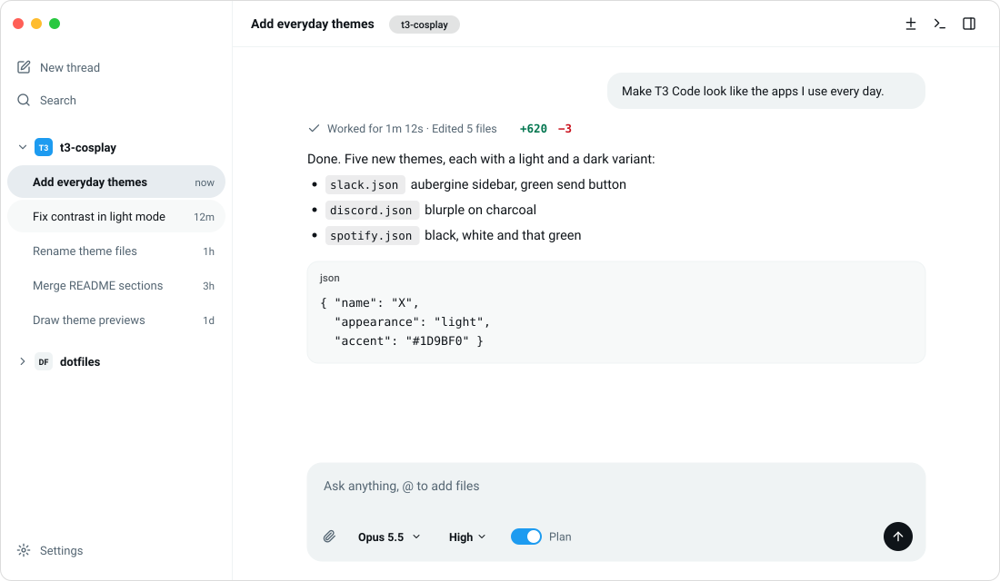</td>
    <td>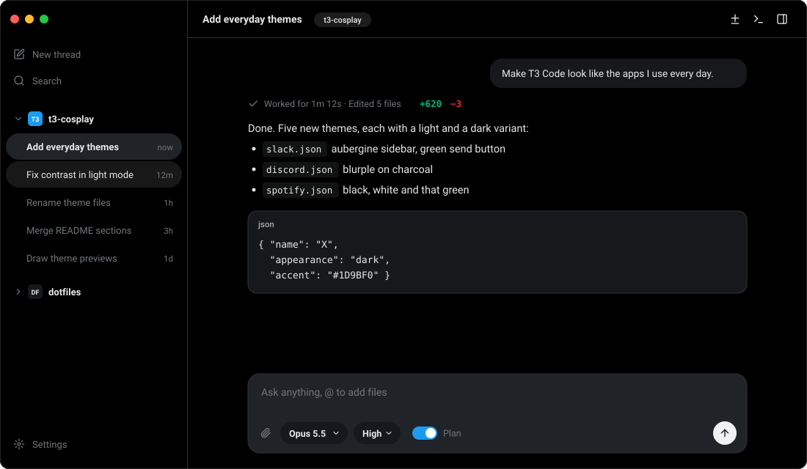</td>
  </tr>
  <tr>
    <td colspan="2"><b>Linear</b></td>
  </tr>
  <tr>
    <td>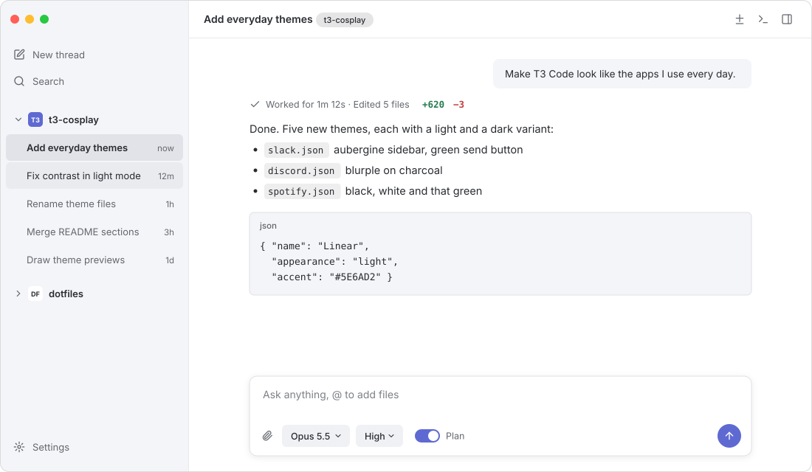</td>
    <td>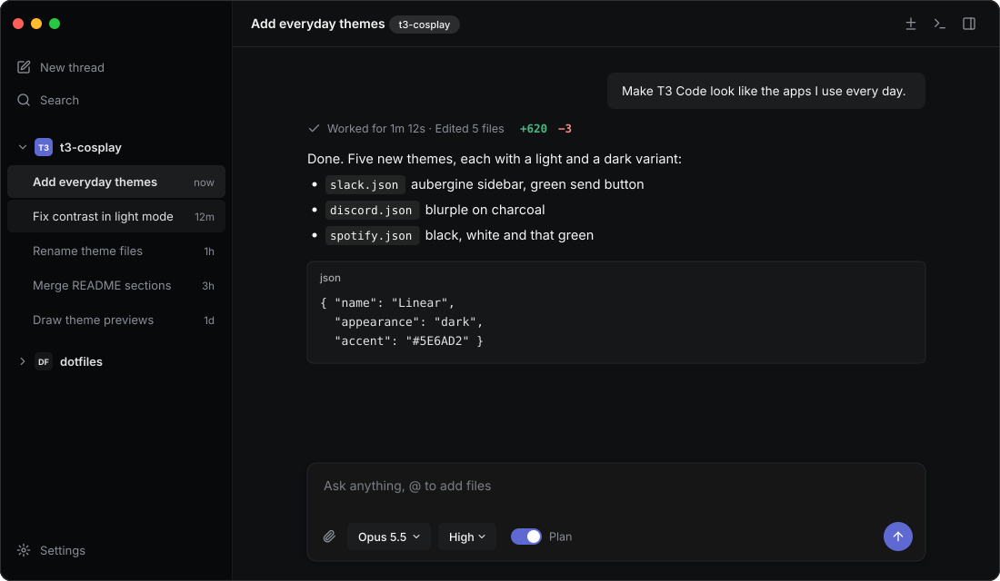</td>
  </tr>
  <tr>
    <td colspan="2"><b>Vercel</b></td>
  </tr>
  <tr>
    <td>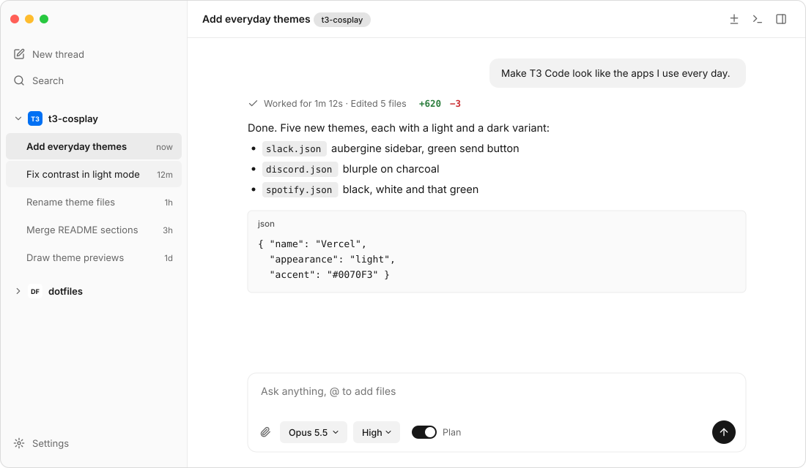</td>
    <td>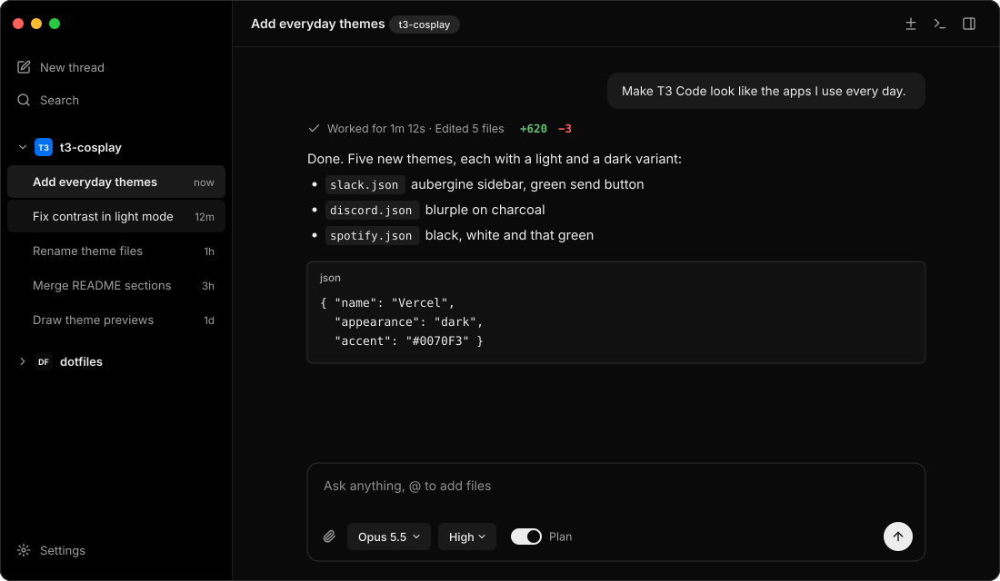</td>
  </tr>
  <tr>
    <td colspan="2"><b>WhatsApp</b></td>
  </tr>
  <tr>
    <td>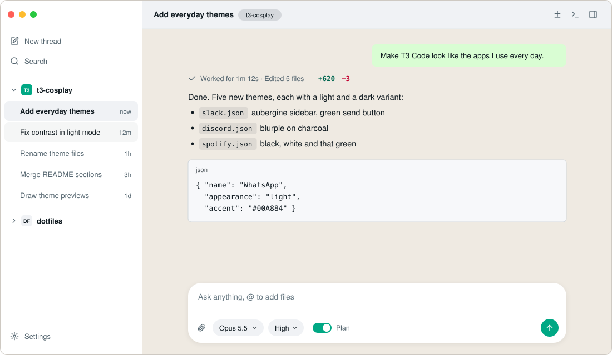</td>
    <td>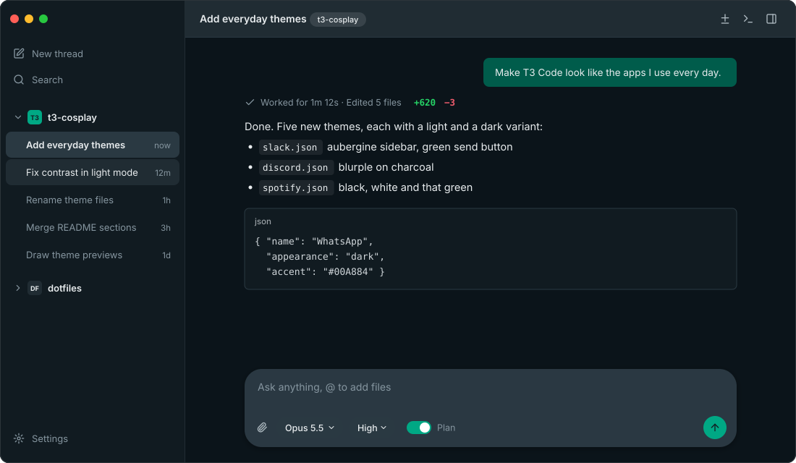</td>
  </tr>
  <tr>
    <td colspan="2"><b>YouTube</b></td>
  </tr>
  <tr>
    <td>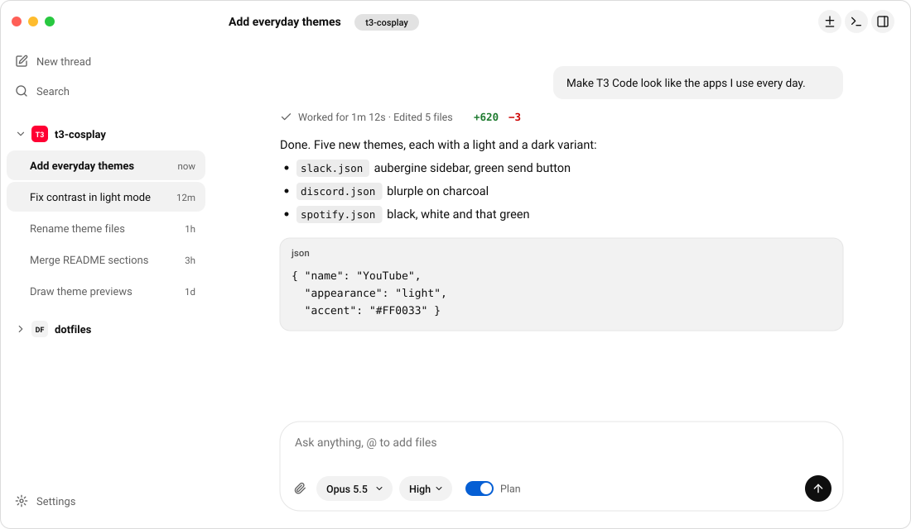</td>
    <td>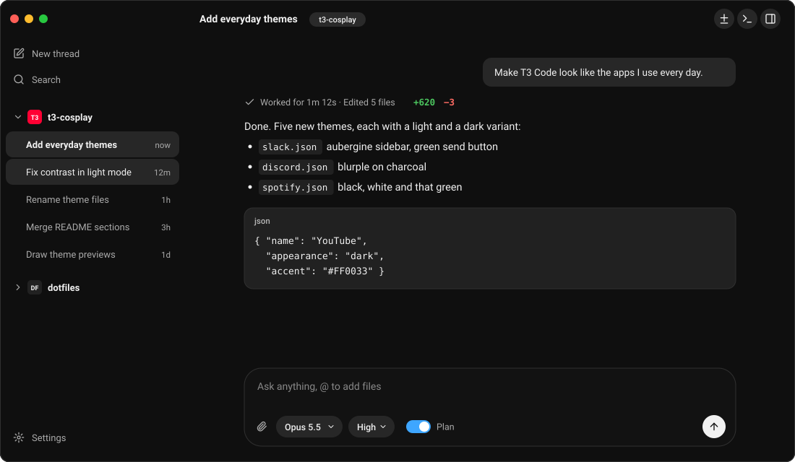</td>
  </tr>
  <tr>
    <td colspan="2"><b>Claude Code</b></td>
  </tr>
  <tr>
    <td>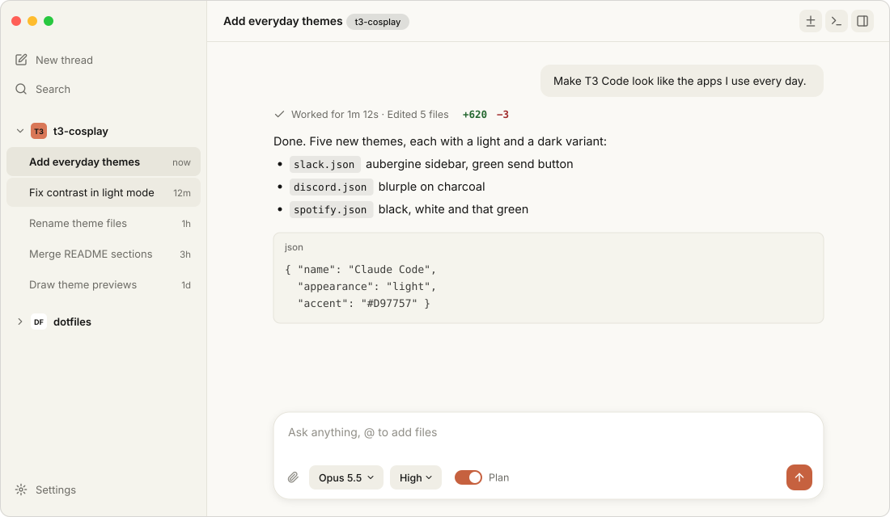</td>
    <td>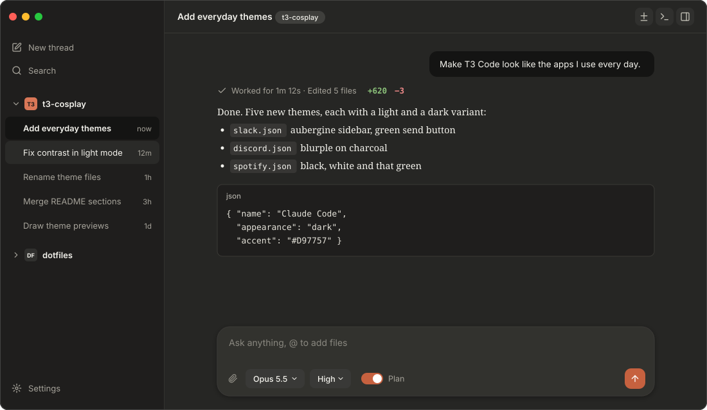</td>
  </tr>
</table>

These are mock windows, not real screenshots. They use T3 Code's real layout and each theme's own colors, corner radii and fonts. To redraw them after you change a theme, run `python3 scripts/previews.py`.

## Install

1. Download the `.json` file you want from [`themes/`](./themes).
2. In T3 Code, open **Settings → Themes** and click **Add theme**.
3. Click **Choose files** and pick the `.json` file, or paste its contents into the box.

That's it: the theme is selected, and its card gets the full set of buttons (duplicate, edit, export, remove) like any theme you made yourself.

> **Don't copy the file into `~/.t3/userdata/themes/`.** T3 Code treats themes in that folder (and themes the agent applies for you) as part of the environment. They only get a duplicate button, so you can't edit or remove them from Settings, only by deleting the file.

## Undo

Click the trash icon on the theme's card in **Settings → Themes**, or just switch back to **T3 Code** (the stock theme).

## Disclaimer

These are fan-made, *inspired-by* themes. They aren't affiliated with or endorsed by Anysphere (Cursor), Microsoft (Teams, GitHub), Salesforce (Slack), Discord Inc., Notion Labs, Spotify, X Corp., Linear Orbit, Vercel, Meta (WhatsApp), Google (YouTube) or Anthropic (Claude Code). No logos, no trademarks, just colors and vibes.

## License

MIT
